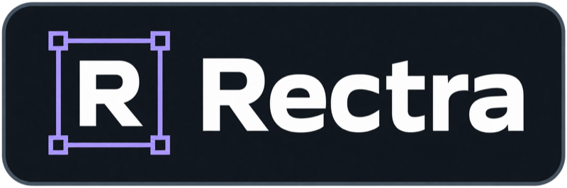
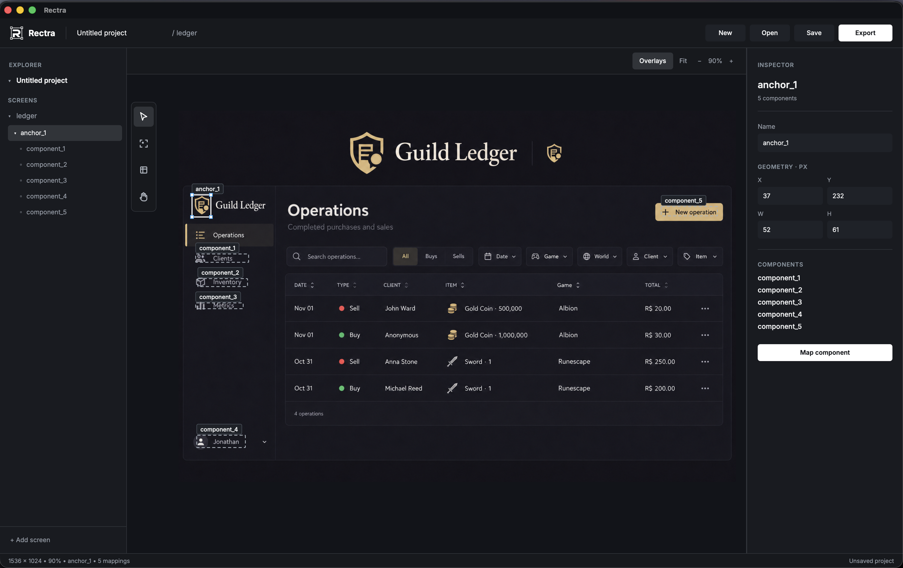

<p align="center">
  
</p>

<p align="center">
  Desktop editor for mapping logical UI components onto screenshot regions defined by anchors.
</p>

<p align="center">
  
  
  
  
  
  
</p>

## Preview

<p align="center">
  
</p>

## Setup

Install **Node.js 22** with **npm**, plus **Rust** [edition 2024](https://doc.rust-lang.org/edition-guide/rust-2024/index.html) (1.85+) and the [Tauri 2 prerequisites](https://v2.tauri.app/start/prerequisites/) for your OS.

```bash
npm install
```

## Usage

```bash
npm run tauri dev
```

Create a project, import PNG or JPEG screens, draw anchors, map components, then **Save** (`.rectra`) or **Export** (`mappings.json` and `templates/`). **Map component** reuses an existing component and keeps its offset. There is no Save As; an export folder is not a project.

The full mapping path, shortcuts, and limits: [Product](docs/PRODUCT.md).

## Architecture

```text
core/     mapping logic (no React)
ui/       workspace and Konva canvas
native/   Tauri window, dialogs, filesystem
```

Boundaries: [Architecture](docs/ARCHITECTURE.md).

## Development

```bash
npm test
npm run build
```

`npm test` runs Vitest. `npm run build` runs `tsc` and Vite into `dist/`. Native file dialogs need `npm run tauri dev`, not `npm run dev` alone.

CI, the rest of the commands, and how a change reaches `main`: [Development](docs/DEVELOPMENT.md).

## Docs

- [Product](docs/PRODUCT.md) — what the editor promises, the flows, and the vocabulary
- [Design](docs/DESIGN.md) — workspace principles and Penpot `Rectra · UI`
- [Architecture](docs/ARCHITECTURE.md) — modules, boundaries, and invariants
- [Development](docs/DEVELOPMENT.md) — commands, tests, and delivery
- [AGENTS.md](AGENTS.md) — map for coding agents
