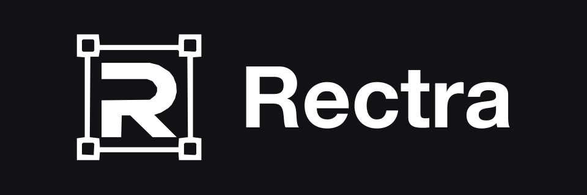
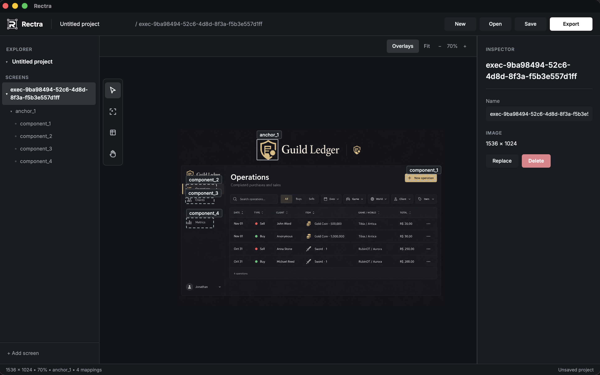

<p align="center">
  
</p>

# Rectra

Desktop editor that maps UI components onto screenshots and exports relative coordinates plus PNG templates. It does not capture windows, run automations, or detect objects.

Anchors are reference regions on the screenshot; logical components (`coord` or `bbox`) get one rectangle per anchor, with offsets derived at export—not stored in the project. Tauri 2, React, TypeScript, Vite, and Konva. UI copy is English.

## Preview

<p align="center">
  
</p>

## Setup

**Node.js** with **npm**, plus **Rust** [edition 2024](https://doc.rust-lang.org/edition-guide/rust-2024/index.html) (1.85+) and the [Tauri 2 prerequisites](https://v2.tauri.app/start/prerequisites/) for your OS.

```bash
npm install
```

## Usage

```bash
npm run tauri dev
```

1. **New** — create a project in memory.
2. Add a screen and import a PNG or JPEG.
3. Draw at least one **Anchor** (`A`), then map **Components** (`C`) on the active anchor. Reuse the same component on other anchors when placements differ.
4. **Save** — first save chooses a folder and writes `<name>.rectra/` (`project.json` + `assets/`). Later saves update that folder. No Save As.
5. **Export** — writes `mappings.json` and one PNG per anchor into a managed folder. Disabled until the project has an anchor. Export packages are not opened as projects.

```bash
npm run tauri build
```

Canvas shortcuts do not run while an input, textarea, select, or dialog is focused; file shortcuts (`Ctrl/Cmd+N`, `O`, `S`, `E`) still do. Component mapping requires a selected anchor.

## Development

```bash
npm test              # Vitest (`tests/**/*.spec.ts`)
npm run test:watch
npm run build         # `tsc` and Vite → `dist/`
npm run dev           # Vite on port 1420; dialogs need `npm run tauri dev`
```

No ESLint or CI in this repo.

## Docs

[`ARCHITECTURE.md`](ARCHITECTURE.md) — modules and boundaries. Penpot `Rectra · UI` — behavior and interface copy.

## Limitations

- One screenshot per screen (PNG/JPEG); replace only when dimensions match.
- No snap, grid, multi-select, Save As, plugins, network, or telemetry.
- Undo does not restore deleted files on disk.
- Export only into folders the app manages (`mappings.json` + `templates/`).
